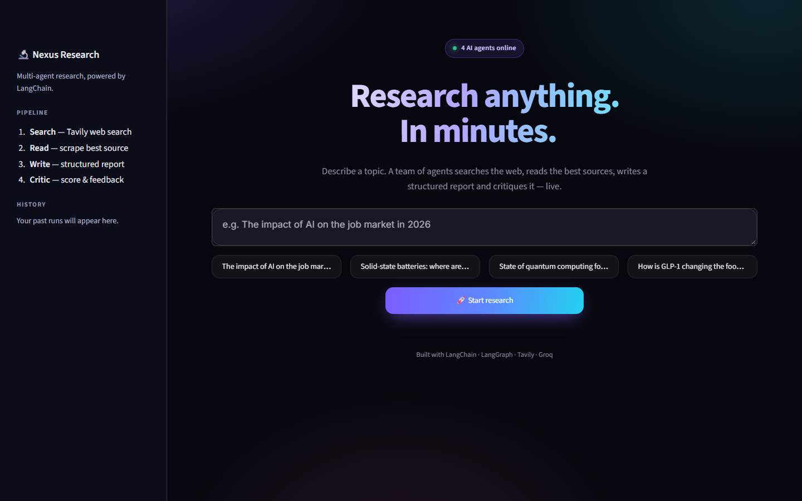
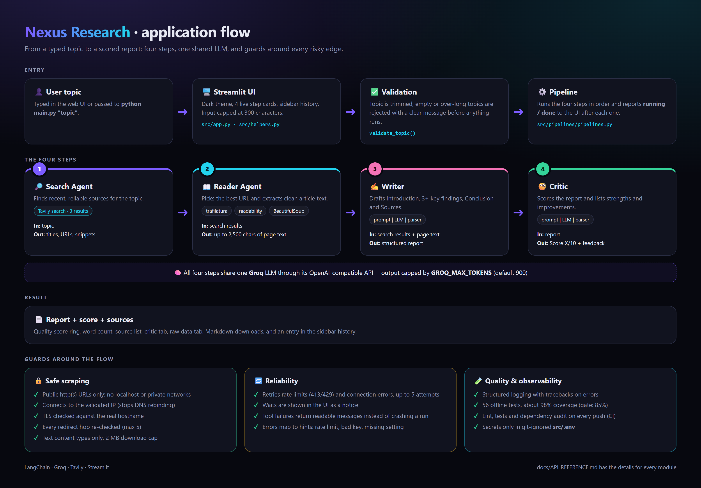
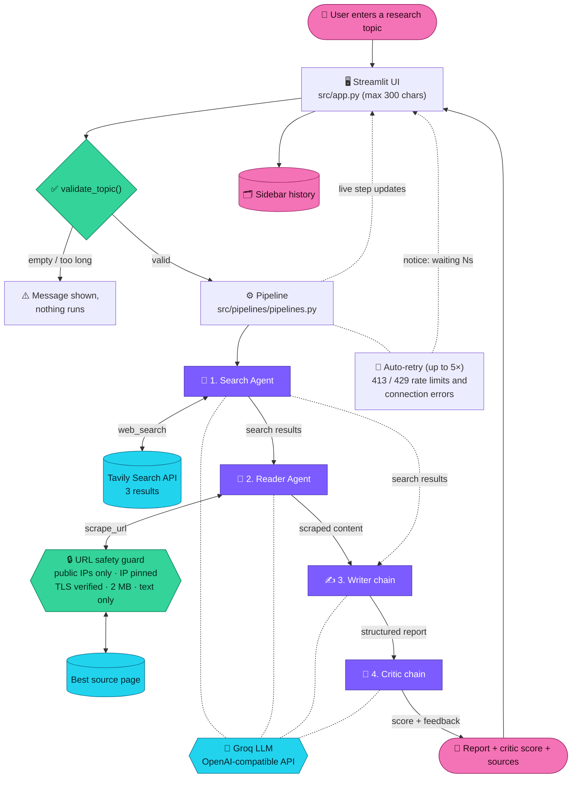

# Nexus Research — LangChain Multi-Agent Research System

A team of four AI agents that researches a topic end to end: it searches the web, reads the best source, writes a structured report, and then critiques and scores it. It ships with a Streamlit UI that shows each agent's progress live.

It is built to be safe to run: the scraper only fetches public web pages, rate limits and network errors are retried automatically, and the code is covered by an offline test suite and CI.

## Screenshot



## Overview



<sub>Source: [docs/application-flow.html](docs/application-flow.html). Open it in a browser and screenshot it at 1600px wide to regenerate the image.</sub>

## Pipeline

1. **Search Agent** — finds up to 3 relevant sources with Tavily web search.
2. **Reader Agent** — picks the best URL and scrapes it (trafilatura, then readability, then plain BeautifulSoup) with safety limits.
3. **Writer** — drafts a structured report from the gathered material.
4. **Critic** — reviews the report and gives a score with feedback.

The LLM is served through Groq's OpenAI-compatible API.

## Application flow



| Step | Component | Input | Output |
|------|-----------|-------|--------|
| 1 | Search Agent | Topic | Search results (links + snippets) |
| 2 | Reader Agent | Search results | Scraped content of the best page |
| 3 | Writer | Search results + scraped content | Structured report |
| 4 | Critic | Report | Score and feedback |

Each step reports `running` / `done` back to the UI, which is what drives the live progress cards. If a retry wait happens, the pipeline also sends a `notice` so the UI can show why the run is paused.

## Project structure

```
├── main.py                     # CLI entry point (python main.py "topic")
├── requirements.txt            # Runtime dependencies
├── requirements-dev.txt        # + pytest, pytest-cov, ruff
├── pyproject.toml              # ruff + coverage settings
├── pytest.ini                  # pytest settings (coverage on by default)
├── Dockerfile / .dockerignore  # Container image (non-root, health check)
├── docs/
│   ├── API_REFERENCE.md        # Developer reference for every module
│   ├── application-flow.png    # Infographic (source: application-flow.html)
│   └── ui-screenshot.png       # UI screenshot
├── tests/                      # Offline unit + pipeline tests (no API keys needed)
├── .github/
│   ├── workflows/ci.yml        # Lint, tests, dependency audit on every push / PR
│   └── dependabot.yml          # Weekly dependency and Actions updates
├── .streamlit/config.toml      # Forces the dark theme
└── src/
    ├── app.py                  # Streamlit UI
    ├── helpers.py              # Pure UI helpers (score parsing, URL extraction, ...)
    ├── .env                    # API keys and model settings (not committed)
    ├── .env.example            # Template for .env
    ├── agents/agents.py        # LLM setup, search and reader agents, writer and critic chains
    ├── pipelines/pipelines.py  # run_research_pipeline, topic validation, retry logic
    └── tools/tools.py          # web_search (Tavily) and the safe scrape_url
```

## Setup

```bash
conda create -n langagent python=3.11 -y
conda activate langagent
pip install -r requirements.txt
```

Alternatively, use a plain virtual environment:

```powershell
python -m venv venv
.\venv\Scripts\activate
pip install -r requirements.txt
```

## Configuration

Copy `src/.env.example` to `src/.env` and fill it in (`src/.env` is git-ignored, so keys are never committed):

```env
TAVILY_API_KEY=your-tavily-key
GROQ_API_KEY=your-groq-key
GROQ_MODEL=your-groq-model-name
GROQ_BASE_URL=https://api.groq.com/openai/v1
GROQ_TEMPERATURE=0
# Optional (defaults to 900)
GROQ_MAX_TOKENS=900
```

## Run

**Web UI (recommended)** — from the project root:

```bash
streamlit run src/app.py
```

Then open http://localhost:8501. Enter a topic and watch the four agents work; past runs appear in the sidebar history.

**Command line:**

```bash
python main.py "Your research topic"
```

With no argument it researches a built-in example topic.

## Development

```bash
pip install -r requirements-dev.txt
ruff check .     # lint
pytest           # tests + coverage (fails below 85%)
```

The tests run offline with dummy keys (56 tests, about 98% coverage) and cover the UI helpers, the scraper (URL safety, pinned-IP connection, size and content-type limits, fallbacks, error messages), the search tool, retry and validation logic, and the full pipeline with fake agents. CI (`.github/workflows/ci.yml`) runs lint, tests and a dependency vulnerability scan (`pip-audit`) on every push and pull request; Dependabot keeps dependencies and actions up to date.

## Docker

```bash
docker build -t nexus-research .
docker run -p 8501:8501 --env-file src/.env nexus-research
```

The image runs as a non-root user, has a health check (`/_stcore/health`) and does not contain your keys; they are passed at runtime.

## Documentation

- [API Reference](docs/API_REFERENCE.md) — functions, data shapes, configuration, limits and error messages for every module.
- [Application flow infographic](docs/application-flow.png) — the whole flow and its guards on one page.

## Notes

- **Logs:** progress, retries and errors (with tracebacks) are printed to the terminal where Streamlit is running. Raise the level to `DEBUG` in `src/app.py` to also log each step's full output.
- **Safe scraping:** the page URL is chosen by an LLM from untrusted search content, so the scraper only fetches public `http(s)` addresses (no localhost or private networks), reads only text content types and at most 2 MB, re-checks every redirect, and connects directly to the IP address it validated while still verifying TLS against the real hostname. That stops DNS tricks between the check and the connection. Proxy environment variables are ignored for scraping for the same reason.
- **Scrape errors** come back as readable text for the agent (for example `Blocked URL: ...`, `TLS certificate verification failed for this site.`, `HTTP error occurred: 404 for <url>`), so one bad page does not crash a run.
- **Retries:** rate limits (HTTP 413 / 429) and connection errors are retried up to 5 times, and the UI shows a notice while it waits.
- **Limits:** topics are limited to 300 characters; output is capped by `GROQ_MAX_TOKENS` (default 900, tuned for Groq's free tier), so long reports can be cut short.
- **History** is kept only for the current browser session.
- `__pycache__/`, `venv/`, `.env` and test/lint caches are listed in `.gitignore`. Optionally set `PYTHONDONTWRITEBYTECODE=1` to stop Python from creating `__pycache__` folders.
