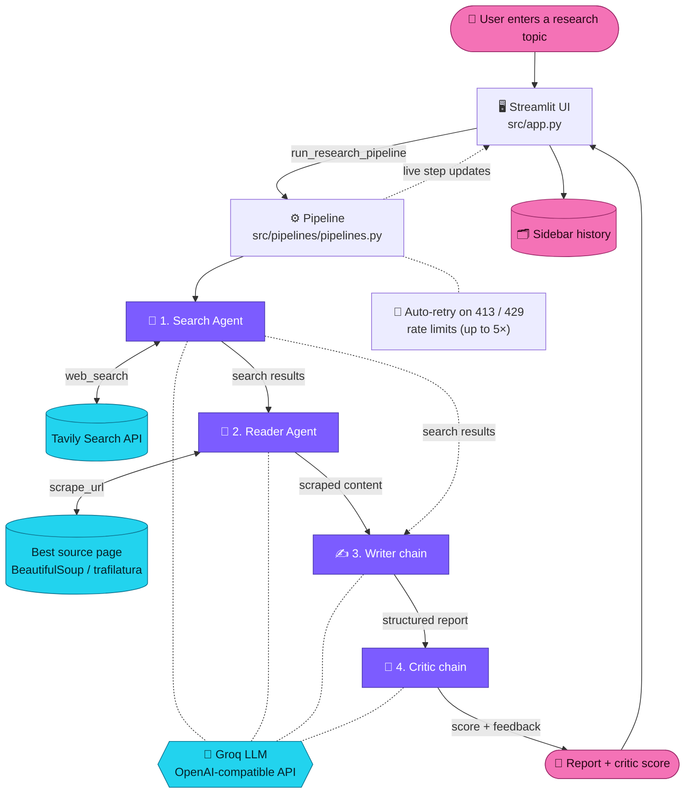

# Nexus Research — LangChain Multi-Agent Research System

A team of four AI agents that researches a topic end to end: it searches the web, reads the best source, writes a structured report, and then critiques and scores it. It ships with a Streamlit UI that shows each agent's progress live.

## Screenshot


## Pipeline

1. **Search Agent** — finds relevant sources with Tavily web search.
2. **Reader Agent** — scrapes the best page (BeautifulSoup / trafilatura / readability).
3. **Writer** — drafts a structured report from the gathered material.
4. **Critic** — reviews the report and gives a score with feedback.

The LLM is served through Groq's OpenAI-compatible API.

## Application flow



| Step | Component | Input | Output |
|------|-----------|-------|--------|
| 1 | Search Agent | Topic | Search results (links + snippets) |
| 2 | Reader Agent | Search results | Scraped content of the best page |
| 3 | Writer | Search results + scraped content | Structured report |
| 4 | Critic | Report | Score and feedback |

Each step reports `running` / `done` back to the UI, which is what drives the live progress cards.

## Project structure

```
├── main.py                  # CLI entry point (runs one topic)
├── requirements.txt
├── .streamlit/config.toml   # Forces the dark theme
└── src/
    ├── app.py               # Streamlit UI
    ├── .env                 # API keys and model settings (not committed)
    ├── agents/agents.py     # LLM setup, search and reader agents
    ├── pipelines/pipelines.py  # run_research_pipeline (with retry logic)
    └── tools/tools.py       # web_search (Tavily) and scrape_url
```

## Setup

```bash
conda create -n langagent python=3.11 -y
conda activate langagent
pip install -r requirements.txt
```

Alternatively, use a plain virtual environment:

```powershell
python -m venv venv
.\venv\Scripts\activate
pip install -r requirements.txt
```

## Configuration

Create `src/.env` (it is git-ignored, so keys are never committed):

```env
TAVILY_API_KEY=your-tavily-key
GROQ_API_KEY=your-groq-key
GROQ_MODEL=your-groq-model-name
GROQ_BASE_URL=https://api.groq.com/openai/v1
GROQ_TEMPERATURE=0
# Optional (defaults to 900)
GROQ_MAX_TOKENS=900
```

## Run

**Web UI (recommended)** — from the project root:

```bash
streamlit run src/app.py
```

Then open http://localhost:8501. Enter a topic and watch the four agents work; past runs appear in the sidebar history.

**Command line:**

```bash
python main.py
```

Edit the `topic` variable in `main.py` to change what gets researched.

## Notes

- Logs are printed to the terminal where Streamlit is running.
- `__pycache__/`, `venv/` and `.env` are listed in `.gitignore`.
- Optionally set `PYTHONDONTWRITEBYTECODE=1` to stop Python from creating `__pycache__` folders.
